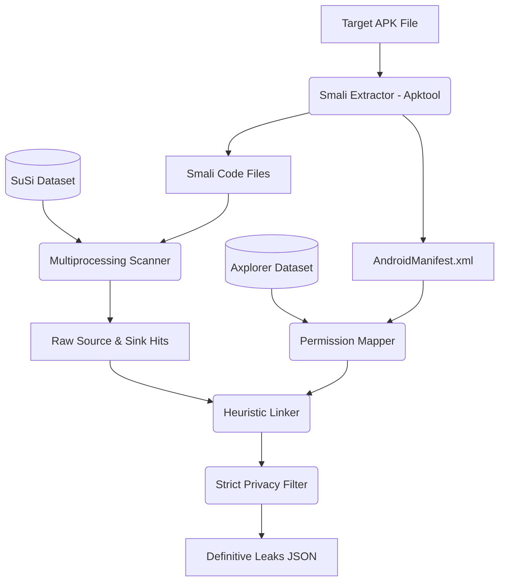

# 🛡️ FYP Defense Guide: The Fallback Static Analyzer

This document is written in simple, plain English to help you understand exactly what your code does, why you built it, and how to defend it during your Final Year Project (FYP) presentation.

---

## 1. The Core Problem (Why you built this)
Your main tool for finding data leaks is **FlowDroid**. FlowDroid uses a technique called *Taint Analysis*, which tracks variables mathematically from the moment they are created until they leave the app.
* **The Good:** It is incredibly accurate. 
* **The Bad:** It requires massive amounts of RAM. If you give FlowDroid a huge app like YouTube or Facebook, the math gets so complicated that the computer runs out of memory (OOM) and crashes.

**Your Solution:** You built a **Fallback Analyzer**. If FlowDroid crashes, your system automatically switches to this fallback tool. Instead of doing heavy math, it reads the app's code like a book and makes highly educated guesses (Heuristics) without ever running out of memory.

---

## 2. How the Fallback Analyzer Works (The Pipeline)

Here is a visual map of how your data flows through the system:

### Step-by-Step Breakdown:
1. **Extraction:** It runs `apktool` to unzip the APK into readable `Smali` code and gets the `AndroidManifest.xml`.
2. **Dataset Loading:** It loads the **SuSi** dataset (to know what malicious functions to look for) and the **Axplorer** dataset (to know what permissions those functions need).
3. **Scanning:** It uses all your computer's CPU cores to quickly scan thousands of Smali files. It searches for any code that matches the SuSi threat list.
4. **Linking:** When it finds a Source (grabbing private data) and a Sink (sending data out), it tries to link them together based on how close they are in the code.
5. **Filtering & Scoring:** It checks if the app actually asked for the required permission. If the permission is missing, or the Source and Sink are too far apart, it deletes the finding to prevent false alarms.

---

## 3. Explaining "The Levels" (Heuristic Proximity)
Because we aren't tracking variables mathematically, we link Sources and Sinks based on how close they are to each other. You only accept **Level 1, Level 2, and Level 3**.

* **Level 1 (Same Method):** The Source and Sink are in the exact same function block. *(Almost certainly a leak).*
* **Level 2 (Same Class):** The Source and Sink are in the same file. *(Very likely a leak).*
* **Level 3 (Same Component):** The Source is inside a button click or background thread (like `MainActivity$1`), and the Sink is in the main file (`MainActivity`). *(Included because Java splits single screens into multiple files during compilation).*

*Why do we block Level 4?* If a Source is on the Settings screen, and a Sink is on the Map screen, connecting them would create a **False Positive**. Because you are comparing these leaks to a Privacy Policy, you must be strict!

---

## 4. Explaining the Datasets
If the professors ask how your tool knows what a leak is, explain your two industry-standard datasets:

1. **SuSi Dataset:** Created by the Secure Software Engineering group. It is a machine-learning generated list of thousands of Android APIs, categorized into **Sources** (sensitive data like GPS, Camera, Phone ID) and **Sinks** (data exits like SMS, Internet, Bluetooth).
2. **Axplorer Dataset:** A scientifically generated map that proves exactly which Java functions require which Android Permissions. By cross-referencing Axplorer, your tool can detect "Dead Code" (malicious code that exists in the app, but is blocked by the Android OS because the developer forgot the permission).

---

## 5. Potential Defense Questions & Answers

**Q: Why didn't you just write your own list of sources and sinks?**
*A: Android has over 100,000 APIs. Writing a list manually is impossible and scientifically inaccurate. By using the official SuSi dataset, my tool relies on peer-reviewed, machine-learning-backed research.*

**Q: What is the main weakness of your Fallback Analyzer?**
*A: False Positives. Because it uses structural proximity (Levels) instead of taint analysis, it might flag a leak if an app grabs the GPS and sends an unrelated Network request inside the same function. However, by strictly limiting the links to Levels 1, 2, and 3, and requiring Axplorer permission validation, I have minimized this weakness as much as statically possible.*

**Q: Why is your tool so much faster than FlowDroid?**
*A: FlowDroid creates a massive mathematical graph in RAM to track every variable in the app. My tool uses Python `multiprocessing` to stream the text files line-by-line using Regex. It trades absolute mathematical precision for infinite scalability.*
